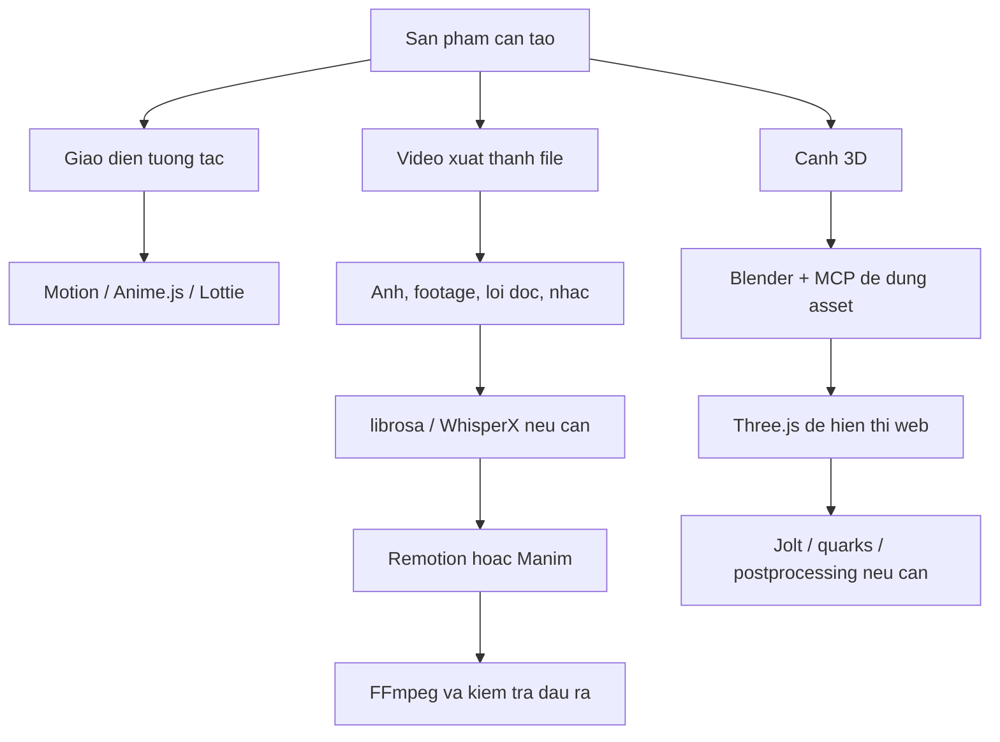
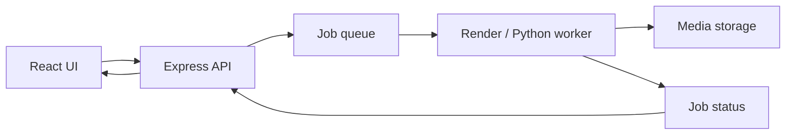

# Quy trình phối hợp và ví dụ tham khảo

[Về chỉ mục](README.md). Các pipeline dưới đây là **đề xuất thiết kế**, chưa được triển khai trong repo. Đoạn mã minh họa API được đọc ngày 04/11/2026, chưa cài dependencies hoặc chạy thử end-to-end.

## 1. Chọn pipeline theo sản phẩm cần tạo



Các nhánh là lựa chọn, không phải yêu cầu dùng hết. Với một chuyển màu hover đơn giản, CSS hiện có có thể đủ. Với video giải thích bằng hình học, Manim có thể là nguồn clip đưa vào Remotion thay vì thay thế toàn bộ quy trình dựng.

### Pipeline A: nâng animation giao diện

1. Chọn một hành vi: mở giỏ hàng, đổi bộ lọc hoặc đổi concept.
2. Đặt React state làm nguồn trạng thái; animation chỉ thể hiện thay đổi.
3. Chọn một engine cho mỗi vùng/thuộc tính: Motion cho state/layout; Anime.js nếu cần timeline DOM/SVG đặc thù; Lottie nếu đã có asset thiết kế.
4. Kiểm tra thao tác liên tiếp, unmount/remount, giảm chuyển động và bàn phím.
5. Đo trên thiết bị mục tiêu trước khi mở rộng sang vùng khác.

Căn cứ API: [Motion](https://motion.dev/docs/react-animation), [Anime.js React scope](https://animejs.com/documentation/getting-started/using-with-react/), [Lottie lifecycle](https://github.com/airbnb/lottie-web).

### Pipeline B: video promo hoặc slideshow

1. Chốt đầu ra: tỉ lệ, kích thước, FPS, duration, nội dung và CTA.
2. Chuẩn bị asset có tên/version rõ. Nếu dùng ComfyUI, xuất workflow API và ghi model/seed/node version; có bước duyệt asset.
3. Chuẩn bị lời đọc trước, xác nhận ngôn ngữ/chất lượng. CosyVoice chỉ là ứng viên với ngôn ngữ đã kiểm tra.
4. Nếu cần: librosa xuất beat theo giây; WhisperX xuất transcript/alignment. Cho phép biên tập lại dữ liệu này.
5. Remotion đọc asset và dữ liệu; mỗi frame phải có thể được yêu cầu độc lập. Với đoạn giải thích hình học, render clip Manim rồi dùng như media đầu vào.
6. Preview đầu/cuối và các thời điểm chuyển cảnh; sau đó render master, chuyển mã bản phát hành và kiểm tra lại.

Căn cứ: [Remotion](https://www.remotion.dev/docs/idea), [ComfyUI API](https://docs.comfy.org/development/comfyui-server/comms_routes), [librosa beat](https://librosa.org/doc/latest/_modules/librosa/beat.html), [WhisperX](https://github.com/m-bain/whisperX). Thứ tự trên là đề xuất, không phải pipeline tích hợp sẵn của các dự án.

### Pipeline C: scene 3D và asset studio

1. Dựng tỷ lệ, camera và lighting trong Blender; lưu scene và kiểm tra hình.
2. Chọn đầu ra: ảnh/video render sẵn hoặc model cho viewer web. Với model, kiểm tra material, texture, số polygon và kích thước file sau export.
3. Tạo viewer Three.js tối thiểu và fallback ảnh; xử lý resize, loading và cleanup.
4. Chỉ thêm Jolt khi cần va chạm; quarks khi cần VFX; postprocessing khi đã có ngân sách GPU.
5. Dùng Tweakpane ở môi trường biên tập/dev để chọn preset có giới hạn.
6. Pathtracer là thử nghiệm riêng: kiểm chứng WebGPU, phiên bản và thời gian hội tụ trước khi nối các thành phần khác.

Căn cứ: [Blender MCP](https://github.com/ahujasid/mcp-for-blender), [Three.js cleanup](https://threejs.org/manual/pages/cleanup.html), [Jolt web binding](https://github.com/jrouwe/JoltPhysics.js), [pathtracer WebGPU](https://github.com/gkjohnson/three-gpu-pathtracer/blob/main/src/webgpu/API.md). Định dạng export và tiêu chí tối ưu là lựa chọn dự kiến cần thử với asset thật.

### Pipeline D: quay hướng dẫn thao tác

OBS quay cửa sổ và các track audio cần thiết → LosslessCut loại đoạn thừa → WhisperX tạo transcript nếu có lời → Remotion thêm tiêu đề/phụ đề khi cần → FFmpeg tạo bản phát hành.

Ưu tiên giữ bản ghi gốc. Kiểm tra điểm cắt thực tế sau LosslessCut; một lần stream copy không bảo đảm cắt trúng frame yêu cầu. [OBS format guide](https://obsproject.com/kb/audio-video-formats-guide), [LosslessCut limitations](https://losslesscut.app/docs/troubleshooting).

## 2. Hợp đồng thời gian

| Loại thời gian | Biểu diễn | Ghi chú |
| --- | --- | --- |
| Media | Giây tương đối từ đầu clip | Không chứa timezone |
| Remotion | Frame video nguyên | FPS là thuộc tính composition |
| librosa mặc định | Frame phân tích âm thanh | Phụ thuộc sample rate và hop length |
| Motion transition | Giây | Không nhầm với Anime.js mặc định |
| Anime.js thông thường | Mili giây | Đọc lại cấu hình engine nếu đổi time unit |
| Booking studio | Ngày/giờ nghiệp vụ | Khác timeline media; giữ quy tắc Asia/Saigon của app |

Đề xuất chuẩn nội bộ: lưu beat/caption theo giây, chỉ đổi sang frame ở biên render. Với FPS nguyên, quy tắc làm tròn chọn cho dự án:

```text
frame = floor(seconds * fps + 0.5)
seconds = frame / fps
audioSeconds = audioAnalysisFrame * hopLength / sampleRate
```

Đây là quy ước đề xuất, không phải định nghĩa dùng chung bắt buộc của các thư viện. Ví dụ 2,5 giây ở 30 FPS tương ứng frame 75; một clip 5 giây có 150 frame đánh số 0–149. Khi FPS là phân số, nên lưu cả tử/mẫu và tránh đổi qua lại nhiều lần. Segment/caption nên dùng khoảng nửa mở `[start, end)` để tránh hiển thị trùng ở ranh giới.

Căn cứ: [Remotion timing](https://www.remotion.dev/docs/idea), [librosa beat units](https://librosa.org/doc/latest/_modules/librosa/beat.html), [Motion duration](https://motion.dev/docs/react-animation), [Anime.js timeline](https://animejs.com/documentation/timeline/).

## 3. Mẫu Motion cho một panel React

Ví dụ tập trung vào animation, chưa bao gồm hành vi dialog như focus trap, trả focus và Escape. Muốn dùng như CartDrawer cần triển khai các hành vi đó trong component thật. Cần package `motion`; chưa thêm vào frontend hiện tại.

```jsx
import { AnimatePresence, motion, useReducedMotion } from 'motion/react';

export function PreviewPanel({ visible, children }) {
  const reduce = useReducedMotion();

  return (
    <AnimatePresence initial={false}>
      {visible && (
        <motion.section
          key="preview-panel"
          initial={{ opacity: 0, x: reduce ? 0 : 24 }}
          animate={{ opacity: 1, x: 0 }}
          exit={{ opacity: 0, x: reduce ? 0 : 24 }}
          transition={{ duration: reduce ? 0 : 0.22 }}
        >
          {children}
        </motion.section>
      )}
    </AnimatePresence>
  );
}
```

Bài học áp dụng: trạng thái `visible` điều khiển tồn tại của panel, còn `AnimatePresence` giữ nó đủ lâu để chạy exit. Không bật thông báo thành công dựa trên `onAnimationComplete`; trạng thái nghiệp vụ đến từ response/backend.

API đối chiếu: [animation](https://motion.dev/docs/react-animation), [accessibility](https://motion.dev/docs/react-accessibility).

## 4. Mẫu Anime.js v4 có cleanup

Chỉ áp dụng cho một vùng trang trí riêng, tránh để engine khác cùng cập nhật `opacity`/`x` trên các phần tử này. Cần package `animejs`.

```jsx
import { useEffect, useRef } from 'react';
import { createScope, createTimeline } from 'animejs';

export function BannerDecoration() {
  const root = useRef(null);

  useEffect(() => {
    const scope = createScope({ root }).add(() => {
      createTimeline()
        .add('.frame-a', { opacity: [0, 1], x: [-16, 0], duration: 350 }, 0)
        .add('.frame-b', { opacity: [0, 1], x: [16, 0], duration: 350 }, 120);
    });
    return () => scope.revert();
  }, []);

  return (
    <div ref={root} aria-hidden="true">
      <span className="frame-a">A</span>
      <span className="frame-b">B</span>
    </div>
  );
}
```

Khi triển khai thật, thêm nhánh tĩnh theo reduced motion. Không sao chép timeline browser này vào composition Remotion mà vẫn để engine tự chạy theo đồng hồ.

API đối chiếu: [timeline](https://animejs.com/documentation/timeline/), [React scope](https://animejs.com/documentation/getting-started/using-with-react/).

## 5. Mẫu Remotion dựa trên frame

Đoạn sau chỉ là component composition. Muốn chạy cần project Remotion, root đăng ký `<Composition>` và package đúng phiên bản; không phải file đã được tích hợp vào Vite hiện tại.

```jsx
import {
  AbsoluteFill,
  interpolate,
  useCurrentFrame,
  useVideoConfig,
} from 'remotion';

export function PromoTitle({ title }) {
  const frame = useCurrentFrame();
  const { fps } = useVideoConfig();

  return (
    <AbsoluteFill style={{ backgroundColor: '#fff8ef', padding: 80 }}>
      <h1
        style={{
          color: '#1b1b1b',
          opacity: interpolate(frame, [0, 0.5 * fps], [0, 1], {
            extrapolateLeft: 'clamp',
            extrapolateRight: 'clamp',
          }),
        }}
      >
        {title}
      </h1>
    </AbsoluteFill>
  );
}
```

Đặt cùng input, cùng asset/font và cùng frame phải cho hình ảnh tương ứng. Tránh `Date.now()`, `setTimeout()` hay random không kiểm soát trong logic tạo hình. Khi có ảnh từ mạng, cần quản lý tải asset theo hướng dẫn của phiên bản Remotion chọn.

API đối chiếu: [core idea](https://www.remotion.dev/docs/idea), [markup](https://github.com/remotion-dev/skills/blob/main/skills/remotion-markup/SKILL.md).

## 6. Tạo beat JSON bằng librosa

Cần Python, librosa và decoder đọc được file. Ví dụ phân tích nhạc đầu vào; không sinh nhạc hay quyết định nghệ thuật thay người dựng.

```python
import json
from pathlib import Path

import librosa

y, sr = librosa.load('music.wav', sr=None, mono=True)
_, beat_seconds = librosa.beat.beat_track(y=y, sr=sr, units='time')

result = {
    'schemaVersion': 1,
    'timeUnit': 'seconds',
    'sampleRate': int(sr),
    'audioOffsetSeconds': 0,
    'beats': [float(t) for t in beat_seconds],
}
Path('beats.json').write_text(
    json.dumps(result, ensure_ascii=False, indent=2), encoding='utf-8'
)
```

Khi dùng trong video, áp dụng offset có chủ đích rồi chuyển sang frame theo quy ước ở trên. Beat array rỗng là kết quả cần xử lý; không tự thay bằng nhịp giả mà không ghi nhận.

API đối chiếu: [beat tracker](https://librosa.org/doc/latest/_modules/librosa/beat.html).

## 7. Dữ liệu trung gian cho media

Đây là **schema gợi ý** cho một pipeline tương lai, chưa có API/bảng database tương ứng. Đường dẫn bên dưới chỉ minh họa; asset không được tạo trong đợt nghiên cứu.

```json
{
  "schemaVersion": 1,
  "templateId": "studio-promo-v1",
  "video": { "width": 1080, "height": 1920, "fps": 30, "durationSeconds": 15 },
  "assets": [
    { "id": "hero", "path": "assets/hero.jpg", "sha256": "<asset-hash>" }
  ],
  "audio": { "path": "audio/narration.wav", "offsetSeconds": 0 },
  "beatsSeconds": [0.5, 1.0, 1.5],
  "captions": [
    { "text": "Aura Studio", "startSeconds": 0.2, "endSeconds": 1.4 }
  ]
}
```

Với job thật, thêm version renderer, model/workflow nếu dùng, revision template và provenance asset. Từ WhisperX không có timing cần đánh dấu để sửa hoặc fallback segment; không ép thành mốc không hợp lệ. Caption dài phải xuống dòng theo khung và font, không chỉ theo số từ.

## 8. Lệnh FFmpeg tham khảo

Các lệnh chỉ được ghi vào tài liệu. Chưa kiểm chứng binary/encoder trên máy trong nhiệm vụ này. Chạy trong thư mục media riêng, dùng input có thật và output mới.

### Kiểm tra metadata

```powershell
ffprobe -v error -show_format -show_streams -of json "input.mp4"
```

### Remux video và audio tương thích sang MP4

```powershell
ffmpeg -n -i "capture.mkv" -map 0:v:0 -map "0:a:0?" -c copy "capture.mp4"
```

`-n` tránh ghi đè. Ví dụ chỉ chọn video đầu và audio đầu nếu có, không giữ tất cả track. MP4 phải hỗ trợ codec nguồn; lệnh này không đổi codec và không resize/burn caption.

### Tạo bản MP4 từ master đã đúng kích thước

```powershell
ffmpeg -n -i "master.mov" -map 0:v:0 -map "0:a:0?" -c:v libx264 -preset medium -crf 20 -pix_fmt yuv420p -c:a aac -b:a 192k -movflags +faststart "publish.mp4"
```

Điều kiện: binary có `libx264`, master có video, kích thước phù hợp pixel format (thường cần hai chiều chẵn). Chọn preset/CRF theo chất lượng đo được. `+faststart` không biến video thành adaptive streaming. Nếu master có alpha, bản phát hành này không giữ alpha.

Nguồn: [FFmpeg stream selection và streamcopy](https://www.ffmpeg.org/ffmpeg.html), [tài liệu đầy đủ](https://www.ffmpeg.org/ffmpeg-all.html), [FFmpeg repo](https://github.com/FFmpeg/FFmpeg).

## 9. Đề xuất tách công việc nặng khỏi web request

Khi có tính năng xuất video/AI thật, kiến trúc ứng viên:



Đề xuất trạng thái: `queued → running → succeeded / failed / cancelled`. API trả job ID sớm; UI đọc tiến độ. Mỗi job có input snapshot, output location, log và timeout; retry phải tránh tạo trùng artifact. Model/FFmpeg/Chromium chạy trong worker có giới hạn tài nguyên, không khóa event loop Express hiện tại.

Đây là hướng thiết kế cho sản phẩm này, chưa xác định queue provider, storage hay triển khai endpoint. Không dùng phần trăm tiến độ giả nếu backend chỉ biết trạng thái giai đoạn.

## 10. Tiêu chí kiểm tra khi triển khai

| Phần | Kiểm tra có ý nghĩa |
| --- | --- |
| UI motion | Mở/đóng nhanh, đổi filter liên tiếp, bàn phím, focus, reduced motion, mobile |
| Video | Frame đầu/cuối, duration/FPS, crop, chữ Việt/font, ranh giới scene |
| Audio | Không clipping, thoại nghe rõ so với nhạc, audio sync đầu và cuối |
| Captions | Dấu tiếng Việt, từ thiếu timing, câu dài, safe area theo kênh đăng |
| 3D | Không mất context khi đổi tab, resize đúng, cleanup bộ nhớ, fallback khi GPU không đáp ứng |
| AI workflow | Model/node version, input/output trace, kiểm tra asset trước dùng |
| Encoding | Probe codec/container/pixel format, phát trên thiết bị đích, file mới không ghi đè master |

Đây là tiêu chí nghiệm thu đề xuất, chưa phải báo cáo những thử nghiệm đã chạy. Chỉ đánh dấu **đã kiểm thử** sau khi có artifact, môi trường và kết quả ghi lại.
