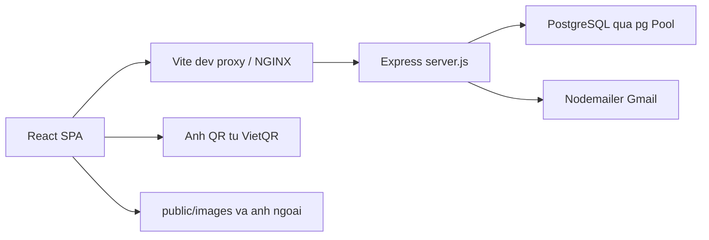
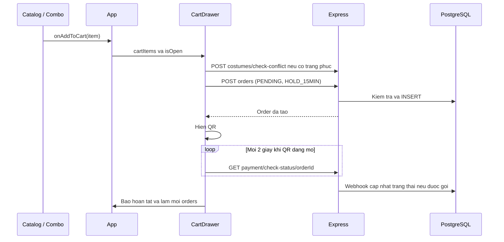

# Bản đồ dự án Photobooth Studio hiện tại

> Mốc khảo sát **trước rework**. Code hiện tại đã đổi; đọc
> [tài liệu bản mới](../rework/README.md) và [API mới](../rework/api.md).
> App cũ ở `frontend/src/LegacyApp.jsx` để tham khảo, không phải entry chạy.

Ngày đọc: **04/11/2026**, Asia/Saigon. Mục đích: nắm code và nghiệp vụ trước khi sửa dự án. Bản đồ này dựa trên checkout hiện tại, gồm các thay đổi setup local từ những lần làm việc trước.

## Tài liệu đi kèm

- [Ghi chú hành vi và vấn đề đã thấy trong code](findings.md).
- [48 route API](api-map.md).
- [Inventory source và SHA-256](source-snapshot.json).
- [Sổ tay 20 công cụ media đã nghiên cứu](../creative-toolkit/README.md).

Đã đọc backend routes/schema/khởi tạo/email, và lần theo phần ghép màn hình, state, effect, handler của các phân hệ frontend. Inventory ghi nhận **37 file JS/JSX/CSS**, khoảng **12.949 dòng** kể cả dòng trống; số này không có nghĩa đã kiểm chứng từng dòng JSX hoặc mọi hành vi end-to-end. Không thực hiện sửa nghiệp vụ trong lượt đọc này.

## 1. Sản phẩm đang làm gì

Đây là web **giới thiệu dịch vụ studio, thuê trang phục, đặt gói chụp, đặt ca Photobooth và quản trị vận hành**. Phần Photobooth đang chọn concept và đặt lịch; trong component hiện tại chưa có luồng webcam, chụp ảnh, in strip hay xuất GIF/video. Những nội dung đó đang là mô tả dịch vụ.

Có hai nhóm giao diện dùng cùng frontend:

| Nhóm | Màn hình đang nối trong App |
| --- | --- |
| Khách hàng | Home, catalog trang phục, combo, Photobooth, lookbook, tra cứu đơn, CartDrawer |
| Quản trị | Dashboard, đơn/phạt/trả đồ, tài khoản nhận tiền/webhook, kho/danh mục, Photobooth, giá, lịch, banner |

Admin được mở bằng state `isAdminMode`, chưa có flow đăng nhập. Tab nhân sự có nhánh placeholder trong App nhưng chưa xuất hiện trong menu admin.

Nguồn: [App.jsx](../../frontend/src/App.jsx), [Header.jsx](../../frontend/src/components/common/Header.jsx), [AdminSidebar.jsx](../../frontend/src/components/admin/AdminSidebar.jsx).

## 2. Kiến trúc chạy



| Lớp | Hiện trạng |
| --- | --- |
| Frontend | React 19, Vite 8, Tailwind CSS 4; JavaScript/JSX |
| State/điều hướng | `useState`, props và render có điều kiện; chưa có router/store dùng chung |
| API client | `fetch('/api/...')` trực tiếp trong component; chưa có lớp client/hooks dữ liệu tập trung |
| Backend | Express CommonJS; toàn bộ 48 route ở `server.js` khoảng 1.884 dòng |
| Database | `pg.Pool`, SQL trực tiếp; schema/ALTER/seed trong `db.js` |
| Email | Template HTML nội suy trong `emailService.js`; gửi qua Nodemailer |
| Asset | Ảnh public/URL bên ngoài hoặc data URL Base64 trong cột TEXT |
| Thư viện đang dùng | `lucide-react`, `canvas-confetti`, `xlsx`; chưa tích hợp toolkit media 20 nguồn |

Nguồn: [frontend manifest](../../frontend/package.json), [backend manifest](../../backend/package.json), [server](../../backend/src/server.js), [db](../../backend/src/db.js).

### Local và Docker

- Local đã setup: frontend `127.0.0.1:5173`, backend cổng 5000, PostgreSQL riêng cổng 55432. Cấu hình riêng và script start/stop nằm trong `.local/`, bị Git ignore.
- `frontend/vite.config.js` proxy `/api` sang backend.
- Docker Compose mô tả PostgreSQL 16, backend và frontend NGINX cổng 80; NGINX proxy `/api` tới backend service.
- Dockerfile frontend dùng `npm ci`, backend dùng `npm install --omit=dev`. Root package chỉ là các script chuyển vào thư mục con, chưa có npm workspace quản lý dependencies chung.
- Không khởi động lại database hoặc chạy Docker trong lượt đọc này.

Nguồn: [Vite](../../frontend/vite.config.js), [NGINX](../../frontend/nginx.conf), [Compose](../../docker-compose.yml), [frontend Dockerfile](../../frontend/Dockerfile), [backend Dockerfile](../../backend/Dockerfile).

## 3. Điểm vào và state điều phối

[main.jsx](../../frontend/src/main.jsx) import `index.css`, bọc App trong StrictMode và ErrorBoundary. ErrorBoundary hiển thị lỗi cùng component stack khi render thất bại.

[App.jsx](../../frontend/src/App.jsx) giữ:

| State | Vai trò / vòng đời |
| --- | --- |
| `currentTab` | Tab khách; đổi tab không cập nhật URL/router |
| `selectedCostumeCategory` | Danh mục truyền vào catalog từ menu |
| `isAdminMode`, `activeAdminTab` | Chuyển khu khách/admin và phân hệ quản trị |
| `cartItems`, `isCartOpen` | Giỏ thuê đồ/combo; tồn tại trong bộ nhớ React |
| `orders` | Tải từ `/api/orders`; dùng cho dashboard/lịch/đơn/thanh toán admin |
| `selectedPackageForBooking` | State còn lại từ flow cũ; handler chọn gói chưa nối vào render hiện tại |

App tải danh sách orders ngay khi mount, kể cả khi khách chưa mở khu admin. Sau tạo đơn gọi lại `fetchOrders()`. Cập nhật/xóa đơn có fallback local khi API lỗi; cần đọc [findings](findings.md) trước khi chỉnh hành vi này.

Tracking truy cập dùng visitor ID trong localStorage, cờ một lần/session trong sessionStorage và timeout 5 giây. Nó ghi nhận một lượt ở thời điểm đó, chưa phải đo toàn bộ thời gian phiên hay chuyển trang.

## 4. Luồng thuê trang phục và combo



### Catalog

[CostumesCatalog.jsx](../../frontend/src/components/customer/CostumesCatalog.jsx) tải costumes/categories, fallback từ `data/costumes.js`, lọc theo danh mục, giới tính và từ khóa. Có card, modal chi tiết và thêm item vào giỏ. Chưa có order line theo size/quantity riêng; danh sách size chủ yếu được hiển thị.

Nội dung title/SEO/features danh mục vẫn lấy từ `CATEGORY_DETAILS` tĩnh, trong khi tên/list danh mục có lấy API. Vì vậy sửa nội dung danh mục ở admin chưa đồng nghĩa toàn bộ nội dung catalog thay đổi.

### Combo

[ComboPackagesSection.jsx](../../frontend/src/components/customer/ComboPackagesSection.jsx) tải packages và addons, cho chọn số người và dịch vụ thêm. Công thức hiện tại:

```text
comboPrice = basePricePerPerson * personCount + sum(selectedAddon.price)
comboDeposit = package.deposit neu co, neu khong thi round(comboPrice * 0.3)
```

Combo được chuyển thành item dùng chung giỏ: `category='combo'`, `rentalPrice=comboPrice`, `depositAmount=comboDeposit`, ID có tiền tố COMBO và thời gian tạo. Không lưu package ID/addon ID dưới dạng bảng order line chuẩn trong database.

### Cart và QR

[CartDrawer.jsx](../../frontend/src/components/customer/CartDrawer.jsx) nhận cart từ App, quản lý bước nhập thông tin và QR. Đang tính:

```text
totalRentalPrice = sum(cartItem.rentalPrice)
totalDepositAmount = sum(cartItem.depositAmount)
grandTotal = totalRentalPrice + totalDepositAmount
```

Số ngày thuê dùng để tính hạn trả và kiểm tra trùng nhưng chưa tham gia công thức tổng phí. Payload order chứa item details dạng chuỗi, costume IDs, ngày, thời lượng thuê, tổng/cọc và trạng thái. Với giỏ combo/trang phục, `timeSlot` còn được dùng làm câu mô tả ngày/thời lượng thay vì luôn là ca chuẩn.

QR động có nội dung chứa mã đơn; khách đợi status từ API mỗi 2 giây. Khi nhận `isPaid`, frontend chạy confetti, chờ 3 giây rồi đóng/xóa giỏ. Khi hủy QR, code có thể DELETE đơn pending.

## 5. Luồng Photobooth

[PhotoboothSection.jsx](../../frontend/src/components/customer/PhotoboothSection.jsx):

1. Đọc concept từ `/api/photobooth`, bank config và các ca chuẩn tĩnh từ `data/bookings.js`.
2. Khi đổi ngày, lấy `/api/orders/booked-slots?date=...`.
3. Chặn ca đã qua theo giờ Việt Nam và ca API trả là đã đặt.
4. Gửi order trực tiếp: `PAID_FULL` hoặc `DEPOSITED_50%`, booking `CONFIRMED`.
5. Nhận success thì lưu order, hiện xác nhận và confetti.

Khác CartDrawer: flow này không đợi webhook/polling trước khi xác nhận. QR được hiển thị theo cấu hình ngân hàng nhưng không tự chứng minh đã nhận chuyển khoản. Đây là hành vi đọc được từ code, chưa chạy tạo đơn/thanh toán trong lượt này.

Backend kiểm tra ca bằng ngày + chuỗi timeSlot và trạng thái không CANCELLED; chưa có resource ID cho cabin/phòng/ekip hoặc kiểm soát capacity theo từng tài nguyên.

## 6. Các phân hệ admin

| Component | Dữ liệu và thao tác đang có |
| --- | --- |
| [AdminDashboard](../../frontend/src/components/admin/AdminDashboard.jsx) | Analytics, biểu đồ doanh thu/visitors, snapshot, xuất XLSX; có fallback số mẫu |
| [AdminOrders](../../frontend/src/components/admin/AdminOrders.jsx) | Tìm/lọc, đổi payment status, hủy/khôi phục, xác nhận trả, phụ phí và xóa |
| [AdminCalendar](../../frontend/src/components/admin/AdminCalendar.jsx) | Tìm order theo ngày/ca, hủy lịch; phân công ekip đang là state local theo slot |
| [AdminInventory](../../frontend/src/components/admin/AdminInventory.jsx) | CRUD trang phục/danh mục, đổi trạng thái kho; ảnh qua canvas thành JPEG data URL |
| [AdminPricing](../../frontend/src/components/admin/AdminPricing.jsx) | CRUD packages/addons và một bộ CRUD Photobooth khác |
| [AdminPhotobooth](../../frontend/src/components/admin/AdminPhotobooth.jsx) | CRUD concept, giá, ảnh kéo-thả, perks và preview |
| [AdminBanners](../../frontend/src/components/admin/AdminBanners.jsx) | CRUD banner, thứ tự, bật/tắt; ảnh URL/Base64 |
| [AdminPaymentSettings](../../frontend/src/components/admin/AdminPaymentSettings.jsx) | Cấu hình bank/QR, bật/tắt auto-confirm trên form, simulator và log callback |

Menu CMS ghi “Banner & Lookbook” nhưng màn hình hiện nối `AdminBanners`; chưa có CRUD lookbook qua backend. “AI Ready” hiện là cấu trúc JSON/XLSX cho dữ liệu, chưa có model AI chạy trong backend.

## 7. Database và hợp đồng dữ liệu

Đã đối chiếu metadata ở PostgreSQL local bằng transaction read-only. Có 11 bảng:

| Bảng | Trường/ý nghĩa nổi bật |
| --- | --- |
| `costume_categories` | ID/tên, title/subtitle/SEO/features JSONB |
| `costumes` | Category chuỗi, giá thuê/cọc INTEGER, trạng thái/số bộ, size/tag JSONB, image TEXT |
| `orders` | Thông tin khách, loại dịch vụ/chi tiết, costume IDs JSONB, ngày/ca, tiền/trạng thái/nhân sự/ghi chú |
| `hero_banners` | Nội dung, image, CTA, is_active, sort_order |
| `service_packages` | Giá/người, cọc, số người/outfit/ảnh, features JSONB |
| `service_addons` | Tên và giá phụ phí |
| `photobooth_concepts` | Code/tên, giá, image và perks JSONB |
| `visitor_logs` | Visitor/page/user agent/IP, duration và ngày/tháng Việt Nam |
| `analytics_monthly_summaries` | Tháng unique, số liệu tổng hợp và AI JSONB |
| `bank_configs` | Một record primary bank, kiểu QR, ảnh QR, webhook key và auto-confirm flag |
| `payment_webhooks` | Transaction/order ID dạng chuỗi, amount, nội dung, status và raw JSONB |

Các bảng có primary key; tháng summary có unique. Metadata hiện không có foreign key, unique ca đặt hoặc unique transaction ID. `orders` chưa có bảng `order_items` hay payment ledger riêng. Date đặt/nhận/trả lưu VARCHAR; phần lớn giá tiền dùng INTEGER.

Hợp đồng API chưa đồng nhất: GET thường trả camelCase; nhiều mutation trả raw row snake_case. Phân loại thuê/chụp dựa vào text `service_type` chứa các từ khóa tiếng Việt, chưa có enum service type dùng chung.

Nguồn: [db.js](../../backend/src/db.js), [server.js](../../backend/src/server.js).

## 8. Thanh toán, email và thống kê

**Webhook:** parse nhiều tên field payload, tìm order theo mã hoặc số điện thoại trong nội dung, ghi log rồi đổi payment/booking status. Đang so một amount của callback với tổng/cọc yêu cầu; chưa có cơ chế cộng dồn và chống xử lý trùng transaction trong schema/handler. Simulator có logic riêng và sửa database thật.

**Email:** được gọi sau khi tạo order nếu có email, kể cả order pending, và có thể gọi lại khi webhook xác nhận. Template hiển thị cọc như tiền đã nhận; lỗi gửi mail được bắt/log, không rollback order. Lượt đọc này không gửi email.

**Analytics:** tracker ghi log và tăng summary tháng. Summary API tính từ orders hiện có nhưng có floor/default số mẫu; các tổng all-time được đưa vào object current month. Snapshot/export là các hành vi riêng; GET export còn cập nhật thời điểm xuất trong DB.

Nguồn: [webhook và analytics](../../backend/src/server.js), [email](../../backend/src/emailService.js), [ghi chú cụ thể](findings.md).

## 9. Mã còn lại và asset

Theo đồ thị import tương đối từ `main.jsx`, những file sau chưa đi vào bundle ứng dụng hiện tại:

- `BookingSlotSection.jsx`: flow đặt gói/ca cũ, gửi trạng thái cọc 30% trực tiếp.
- `PackagesSection.jsx`: màn hình chọn gói cũ, hiện App dùng `ComboPackagesSection`.
- `MixMatchBuilder.jsx`: phối ảnh/trang phục/phụ kiện tĩnh, chưa được render từ App.
- `App.css`: style template Vite cũ, chưa được import.

Phân tích import là tĩnh, không phải đề xuất xóa ngay. Đã thấy ba image path không có file trong `public`: hai backdrop thuộc builder cũ và ảnh vest thứ ba trong lookbook đang dùng. Danh sách chính xác ở [snapshot](source-snapshot.json).

`index.css` là lớp style dùng thật, cộng với utility Tailwind trong JSX. Font khai báo trong CSS và font tải ở `index.html` chưa trùng hoàn toàn; một số class animation cần đối chiếu CSS sinh ra trước khi coi là đã có hiệu ứng.

## 10. Kiểm tra baseline đã thực hiện

| Kiểm tra | Kết quả |
| --- | --- |
| `npm run build` frontend | Thành công; JS khoảng 503,39 kB trước gzip, có cảnh báo chunk trên 500 kB |
| `npm run lint` frontend | Exit 0; có nhiều warning unused, một unused expression và warning effect dependencies |
| HTTP frontend | 200 tại cổng 5173 |
| Health qua Vite proxy | OK, query database thành công |
| GET categories/costumes/packages/addons/photobooth/banners | Thành công; lần lượt 9/12/3/4/3/3 record |
| Metadata/query DB read-only | 11 bảng; hiện 0 order và 0 webhook log |

Không có test script hoặc thư mục test của ứng dụng được thấy trong inventory hiện tại. Build/lint không xác nhận business correctness. Chưa chạy end-to-end tạo/sửa đơn, webhook, checkout, email hay Docker; các vấn đề trong [findings](findings.md) phần lớn được xác định bằng đường code cụ thể.

## 11. Điểm chạm cần nhớ khi sửa

| Muốn sửa | Các phần cần đọc cùng nhau |
| --- | --- |
| Layout/menu | App, Header/Footer, AdminSidebar/Header, index.css |
| Giá/checkout | ComboPackagesSection, CartDrawer, POST orders, email và dashboard |
| Lịch/giữ chỗ | PhotoboothSection, TIME_SLOTS, booked-slots, POST orders, conflict helper, AdminCalendar |
| Kho/trả đồ | Catalog, Inventory, costume schema, conflict helper, confirm-return |
| QR/thanh toán | CartDrawer, PhotoboothSection, AdminPaymentSettings, bank config, webhook/status/simulator |
| Báo cáo | AdminOrders penalty, Dashboard, analytics summary/snapshot/export, seed DB |
| Nội dung/ảnh | AdminBanners/Photobooth/Inventory, data tĩnh, API mapping và public asset |

Trước khi đổi cấu trúc nên xác định hợp đồng dữ liệu và trạng thái nghiệp vụ cần giữ. Lượt đọc này cung cấp bản đồ và bằng chứng để bắt đầu sửa theo yêu cầu tiếp theo.
